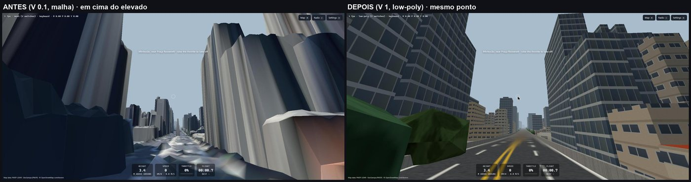
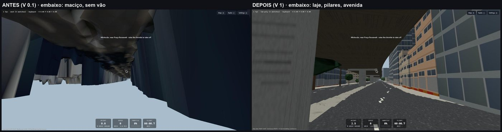
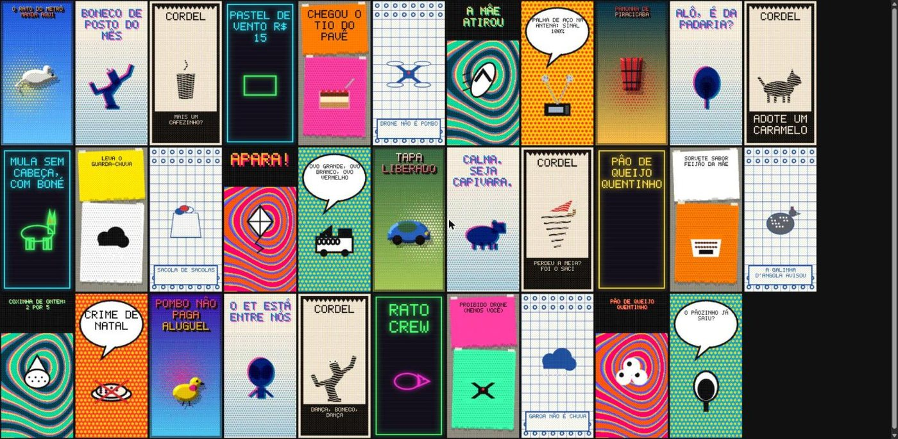
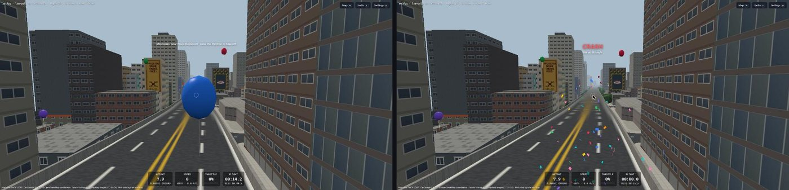

# FPV Minhocão

**▶ Play: https://kschiavo-beep.github.io/fpv-minhocao/**

An FPV drone simulator over São Paulo's Minhocão (Elevado Presidente João Goulart), rebuilt as a low-poly,
Nintendo-64-flavoured city from the São Paulo city hall's public LiDAR survey. Fly under the viaduct, between the
buildings, past made-up murals on blind walls, and pop all the balloons.

Single HTML file, runs in the browser (three.js). Keyboard, mouse or a real radio (USB gamepad, e.g. an FPV
controller) with Betaflight-style rates and calibration.

## Controls

| Key | What it does |
| --- | --- |
| Throttle up | take off |
| `V` | switch views: low-poly / mesh / points / mesh + points |
| `T` | camera tilt, in steps |
| `M` | map: click and drag to choose the start point |
| `H` | start point here |
| `R` | restart · `Space` pause |
| **Radio** panel | pick the gamepad, calibrate sticks, rates, camera axis (relative, absolute or steps) |
| **Settings** panel | textures (N64 smooth / pixel), outside ground, balloons (regenerate / auto-regenerate) |

Hit every one of the 150 balloons for a prize.

## How it was made

`pipeline/` holds the Python and JavaScript steps, numbered in order (see `pipeline/README.md`):

- **LiDAR** (PMSP, `MDS_color` tiles, EPSG:31983) cut along the viaduct into a strip and classified: street level,
  sidewalks, viaduct deck, buildings, trees.
- Cross-checked with **OpenStreetMap** and **GeoSampa** (sidewalks, building heights, trees, blocks).
- **Low-poly scene**: straightened buildings and viaduct ("poetic licence"), pillars you can fly between,
  procedural 64 px textures, tree crowns, collision with the deck slab, pillars and crowns.
- **Facade colours** sampled from street-level photos on **Mapillary** (API token read from the
  `MAPILLARY_TOKEN` environment variable, never stored).
- **Murals**: blind walls get silly, made-up Brazilian paintings in eight styles (N64, risograph, linocut, neon,
  lambe-lambe, azulejo, op-art, pop). One wall carries a tribute portrait of Elis Regina, made with an image AI.
- Victory jingle: original chiptune made in code (`pipeline/75_victory_jingle.py`).

The raw LiDAR, Mapillary images and intermediate files (~1 GB) are not in the repository; the scripts download
and rebuild them.

## Credits and licences

- Map data: São Paulo city hall (PMSP) LiDAR survey and GeoSampa · © OpenStreetMap contributors (ODbL).
- Facade colours derived from Mapillary images (CC-BY-SA 4.0).
- Wall paintings are made up. Elis Regina tribute illustration made with an image AI.
- 3D engine: three.js (MIT).
